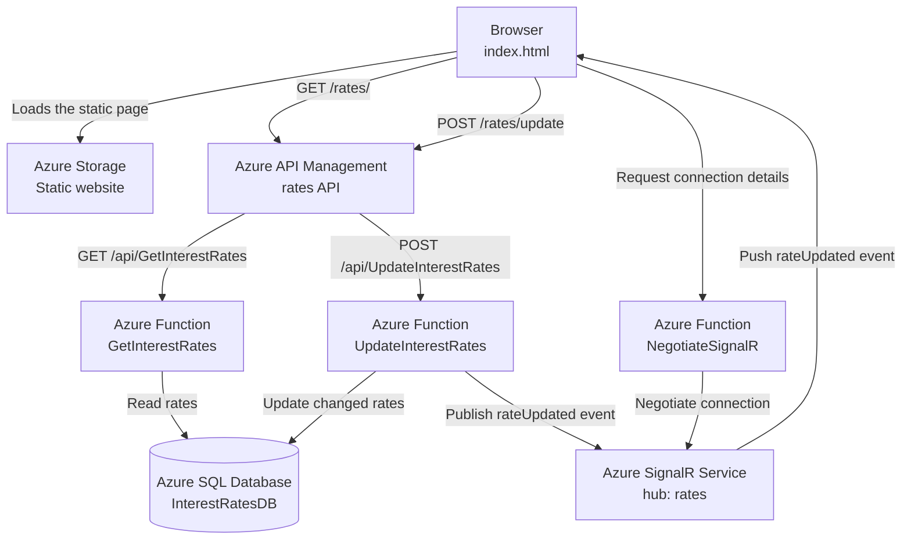
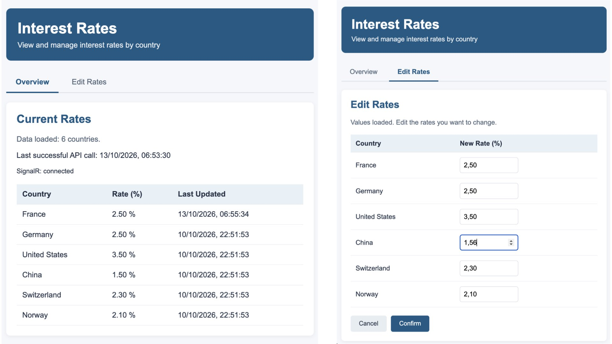

# Event-driven webpage update using Azure backend services

## Overview

This project demonstrates an event-driven web page that displays interest rates and updates the displayed values in real time when a rate changes.

The web page is hosted as a static website in Azure Storage. Azure API Management exposes the HTTP API used by the page. Azure Functions reads and updates the data in Azure SQL Database, while Azure SignalR Service pushes change notifications to connected browsers.

This repository contains the web page and project documentation. Azure resources are provisioned and configured separately; this repository does not currently recreate the infrastructure or deploy the application automatically.

## Architecture

Front-end URL
https://webapprealtimersa.z6.web.core.windows.net



### Azure services

| Component | Responsibility |
|---|---|
| **Azure Storage static website** | Hosts `index.html`, the browser-based user interface. |
| **Azure API Management (APIM)** | Provides the API entry point for reading and updating rates, and applies policies such as CORS and backend routing. |
| **Azure Functions** | Implements the HTTP endpoints for retrieving rates, updating rates, and negotiating a SignalR connection. |
| **Azure SQL Database** | Stores the interest rates and their last-updated timestamps. |
| **Azure SignalR Service** | Sends rate-change events to connected browsers through the `rates` hub. |
| **Managed identity** | Allows the Function App to authenticate to Azure SQL Database without embedding a SQL username and password in the application code. |

## Request and event flows

### 1. Initial page load and rate retrieval

1. The browser loads `index.html` from the Azure Storage static website.
2. The page sends a `GET` request to the APIM rates API.
3. APIM routes the request to the `GetInterestRates` Azure Function.
4. The function reads the current rates from Azure SQL Database and returns them to the page.
5. The page renders the rates and displays the time of the last successful API call.

### 2. Establishing the real-time connection

1. The page calls the `NegotiateSignalR` Azure Function to obtain the information needed to connect.
2. The function returns the SignalR connection information.
3. The browser connects to Azure SignalR Service and listens for the `rateUpdated` event on the `rates` hub.

### 3. Updating rates

1. A user changes one or more values in the page's **Modification** view and confirms the changes.
2. The page sends a `POST` request to the APIM endpoint `/rates/update`, with the rates in a JSON request body.
3. APIM routes the request to the `UpdateInterestRates` Azure Function and supplies the required Function key through a secret named value.
4. The function validates the submitted rates and updates changed values in Azure SQL Database.
5. If any rates changed, the function publishes a `rateUpdated` event through Azure SignalR Service. The event includes the changed countries and rates.
6. Connected browsers apply the changed values directly to the displayed table, without making another GET request just because the event arrived.

If no values changed, the function does not need to publish a change event.

### 4. Resynchronization and fallback

The page retrieves rates when it first loads and resynchronizes after a SignalR reconnection. A periodic fallback refresh is also available in the page code and is configured for 55 minutes when enabled. This fallback can be disabled if desired; the initial load and reconnection resynchronization should remain.

## API routes used by the page

| Method | APIM route | Purpose |
|---|---|---|
| `GET` | `/rates/` | Retrieve the current rates. |
| `POST` | `/rates/update` | Validate and save the submitted rates. |

The APIM operations route to the Azure Functions `GetInterestRates` and `UpdateInterestRates` respectively. The `NegotiateSignalR` endpoint is called directly by the browser to establish the SignalR connection.

## Security notes

- Do not commit Function keys, database credentials, connection strings containing secrets, access tokens, or other credentials to this repository.
- The APIM Function key is stored in an APIM secret named value and is applied by the POST operation policy.
- The Function App uses managed identity to authenticate to Azure SQL Database.
- CORS is configured to allow the static website origin to call the API. When changing the hosting origin, review the CORS configuration in APIM and the Function App.
- Keep the repository private if the project or its configuration is not intended for public release. A private repository is not a substitute for removing secrets from files and Git history.

## Repository contents

The repository is intended to contain the static page and its documentation, for example:

```text
rates-realtime-update/
├── index.html
├── README.md
└── screenshots/
    ├── InterestRatesRealTimeUpdate_FrontEnd.jpeg
```

The screenshot files are optional and should be added after capturing the relevant page views. Reference them from this README once they are present.

## Screenshots

Add screenshots of the English-language page here when available.

For example, after adding the image files under `screenshots/`:

```markdown
### Rate display



```

## Current scope

This repository documents the web page and its Azure architecture. It does not currently include Terraform definitions for the Azure infrastructure or an automated deployment workflow. The Azure services remain configured separately in Azure.

## Website sleep mode and recovery
* Upload index.html to the $web folder within the storage container
* Turn off/ turn on the Azure function app
* Website URL (primary endpoint): https://webapprealtimersa.z6.web.core.windows.net/
